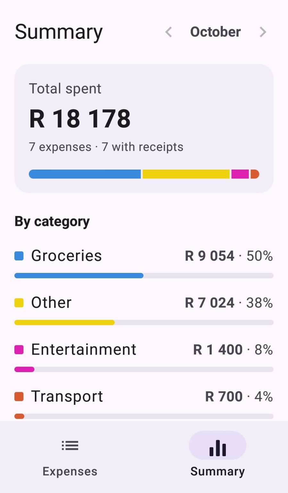
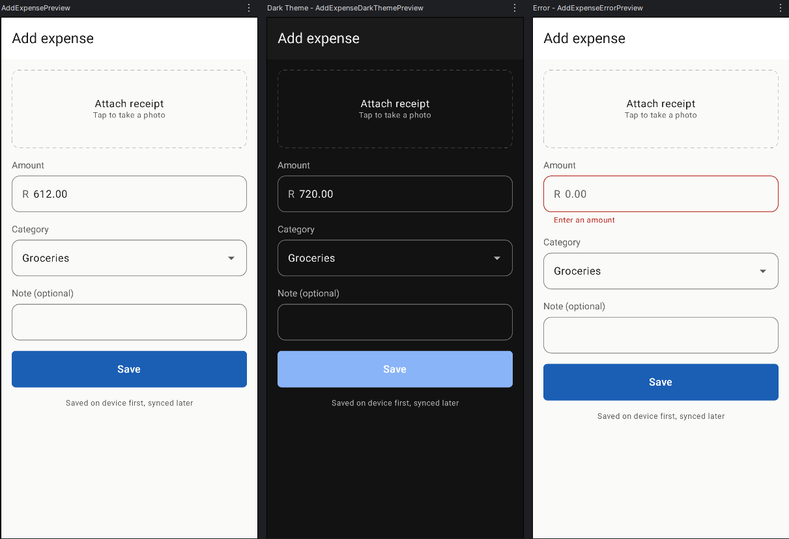
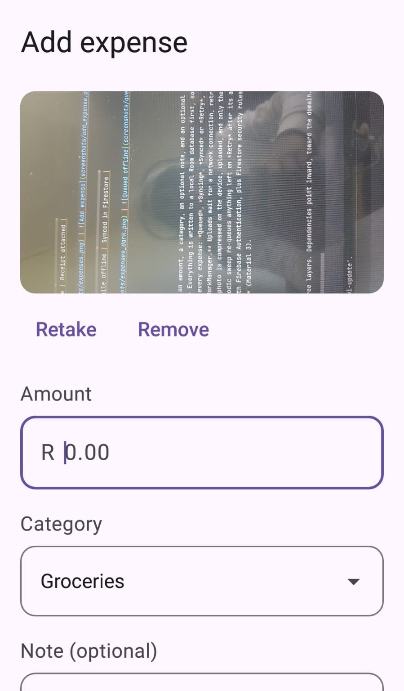
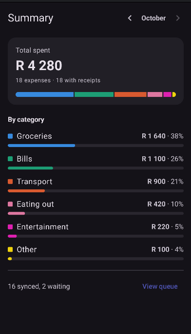
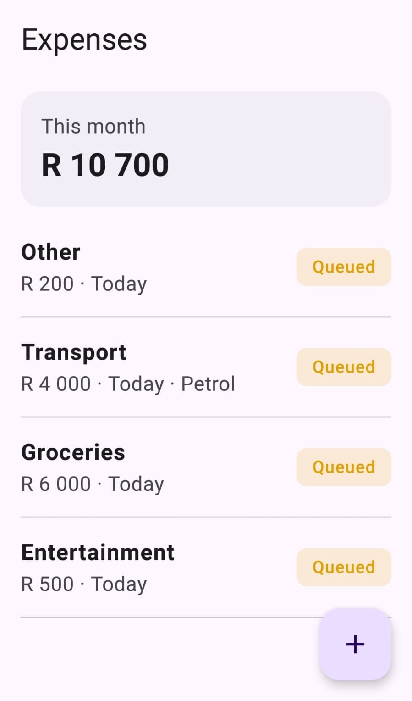
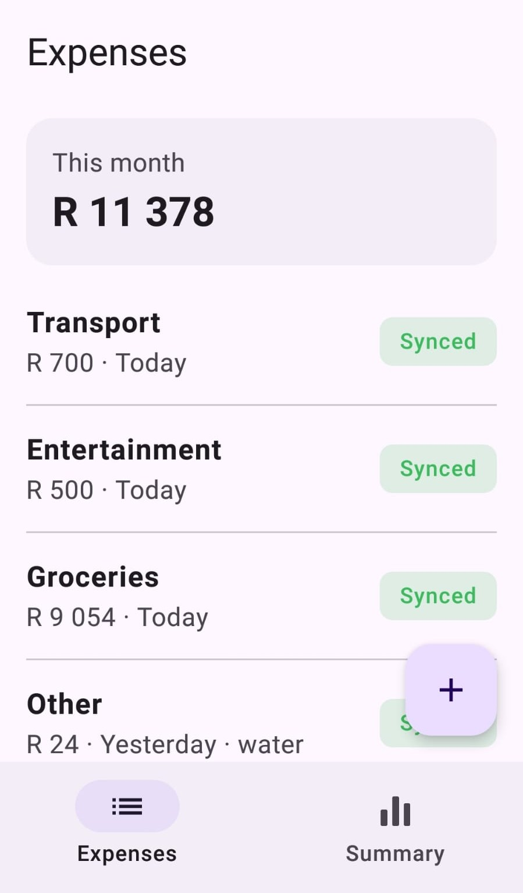

# SlipStash 🧾

SlipStash is an offline-first expense tracker for Android. You record an expense and an optional receipt photo, and it is saved on the phone instantly, even with no signal. A background job then syncs it to Firebase when a connection is available, retrying on its own if anything fails.

The project is built to demonstrate offline-first design, background work with WorkManager, and Firebase integration, on a Clean Architecture foundation.

---

## 📱 Screenshots

| Expenses Summary | Add expense | Receipt attached                      |
|---|---|-------------------------------------------------------|
|  |  |  |

| Dark theme | Queued while offline                              | Synced in Firestore                              |
|---|---------------------------------------------------|--------------------------------------------------|
|  |  |  |

---

## ✨ Features

- **Add an expense** with an amount, a category, an optional note, and an optional receipt photo.
- **Works fully offline.** Everything is written to a local Room database first, so saving never waits for the network.
- **Live sync status** on every expense: *Queued*, *Syncing*, *Synced* or *Retry*, driven by a status column in Room and observed through Kotlin Flow.
- **Background sync with WorkManager.** Uploads wait for a network connection, retry with exponential backoff, and run even if the app is closed.
- **Receipt pipeline.** A photo is compressed on the device, uploaded, and only then is the expense itself synced, using chained WorkManager jobs.
- **Self-healing.** A periodic sweep re-queues anything left on *Retry* after its attempts ran out, or saved without a queued job.
- **Anonymous sign-in** with Firebase Authentication, plus Firestore security rules so each user can only access their own data.
- **Light and dark themes** (Material 3).

---

## 🔍 Architecture

Clean Architecture with three layers. Dependencies point inward, toward the domain.

```
presentation/   → Compose screens, ViewModels, navigation
domain/         → Models, repository contracts, use cases (no Android, Room or Firebase)
data/           → Room, Firebase, WorkManager, mappers
```

### Key decisions

- **Repository pattern.** The domain defines the contracts (`ExpenseRepository`, `ExpenseRemoteRepository`, `AuthRepository`, `ReceiptStorage`, `SyncScheduler`). The data layer implements them, and the rest of the app only sees the interfaces.
- **Use cases hold the rules.** For example, `AddExpenseUseCase` rejects amounts of zero or less, creates every expense as `PENDING`, and schedules the sync. `SyncExpenseUseCase` moves an expense through `SYNCING` to `SYNCED` or `FAILED`.
- **WorkManager stays out of the domain.** The domain only knows a `SyncScheduler` interface, and the WorkManager implementation lives in `data/work`.
- **Money is stored as integer cents,** never as a floating-point number, and formatted only in the UI.
- **IDs are UUID strings,** created on the device. The same ID becomes the Firestore document ID, so a retried upload overwrites itself instead of creating a duplicate.
- **Stateless screens.** Each screen is a thin wrapper around the ViewModel plus a stateless content composable, so every screen can be previewed without Hilt.
- **Dependency injection with Hilt,** including `@HiltWorker` for the background jobs.

---

## 🔄 How sync works

```
Save expense
  │
  ├─► Room (status = PENDING)                       ← instant, works offline
  │
  └─► WorkManager unique work  "sync_<expenseId>"
        │
        ├─ [only if there is a photo]
        │    1. Compress photo  (no network needed)
        │    2. Upload receipt  (needs network, retries with backoff)
        │
        └─ 3. Sync expense      (needs network, retries with backoff)
                 PENDING → SYNCING → SYNCED   (or FAILED)

Every ~15 minutes (while online)
  └─► Retry sweep: re-queue anything still PENDING, SYNCING or FAILED
```

- **No duplicate jobs.** Each expense's work is unique, and enqueued with `KEEP`, so saving or sweeping can never queue the same expense twice.
- **Unique work stops duplicates.**
- **Retries.** Workers retry up to five times with exponential backoff, then mark the expense *Retry*. The periodic sweep picks it up later.
- **Cancellation is not failure.** If the system stops a job, the use case re-throws the cancellation and does not record a failure.

---

## ☁️ Firebase

| Service | Use |
|---|---|
| Authentication | Anonymous sign-in, giving each install a user ID |
| Cloud Firestore | Stores expenses and receipt images |

Firestore layout:

```
users/{uid}/expenses/{expenseId}   → amount, category, note, date, receipt reference
users/{uid}/receipts/{expenseId}   → compressed JPEG (blob), size, created time
```

Security rules, so each user can only touch their own data:

```
rules_version = '2';
service cloud.firestore {
  match /databases/{database}/documents {
    match /users/{userId}/{collection}/{docId} {
      allow read, write: if request.auth != null && request.auth.uid == userId;
    }
  }
}
```

### Why receipts are in Firestore and not Cloud Storage

Cloud Storage for Firebase needs the Blaze (pay-as-you-go) plan, and this project runs on the free Spark plan. Receipts are compressed on the device (maximum 1280 px on the long side, JPEG, aimed at about 300 KB) so they fit within Firestore's document size limit of about 1 MiB.

The upload goes through a `ReceiptStorage` interface. Moving to Cloud Storage means writing one new implementation and changing one binding in a Hilt module. Nothing else changes.

---

## 🛠️ Tech stack

- Kotlin, Jetpack Compose (Material 3), Navigation Compose
- MVVM with `StateFlow`
- Hilt (with `hilt-work` for workers)
- Room, with schema export enabled
- WorkManager (chained work, constraints, backoff, periodic work)
- Firebase Authentication and Cloud Firestore (BoM 34.11.0)
- Kotlin Coroutines and Flow
- KSP (no kapt)
- Android Gradle Plugin 9.0.1, min SDK 26, target SDK 36
- JUnit and `kotlinx-coroutines-test`, with hand-written fakes

---

## 🧪 Testing

Use cases are unit tested against fakes, so the tests run on the JVM in seconds, with no emulator, network or Firebase.

- `AddExpenseUseCase`: validation, `PENDING` status, trimmed notes, scheduling with and without a receipt
- `RetryFailedSyncsUseCase`: which statuses are re-queued, and when the receipt chain is requested
- `SyncExpenseUseCase`: success, upload failure, sign-in failure, unknown ID, the `SYNCING` state during upload, and cancellation handling

Run them with:

```bash
./gradlew testDebugUnitTest
```

---

## 🚀 Getting started

1. Create a project in the [Firebase console](https://console.firebase.google.com).
2. Register an Android app with the package name `com.oddzmint.slipstash` and download `google-services.json` into the `app/` folder.
3. Enable **Authentication → Sign-in method → Anonymous**.
4. Create a **Firestore** database and publish the rules above.
5. Make sure Gradle uses a full JDK 17 or newer (in IntelliJ: *Settings → Build Tools → Gradle → Gradle JDK*).
6. Run the app on a device or emulator.

> `google-services.json` is not included in this repository. The app needs your own file to build.

---

## ⚠️ Known limitations and roadmap

- Anonymous accounts live on the device, so reinstalling the app creates a new user. Upgrading to email or Google sign-in (which can link an anonymous account) is planned.
- Receipts are stored in Firestore, as explained above. Moving to Cloud Storage is a one-class change.
- Planned: monthly summary screen with a category breakdown, an offline indicator, receipt thumbnails in the list, a WorkManager worker test using `TestListenableWorkerBuilder`, Firebase App Check, and cleanup of local photos that were retaken or removed.
- The periodic retry runs at roughly 15-minute intervals at best, because that is WorkManager's minimum and Android may delay it to save battery.

---

## 🔒 Privacy

Expenses and receipt photos are stored locally first and then synced to the developer's own Firebase project under an anonymous user ID. The app uses no analytics and no advertising.

---

## ⚖️ License

Created by Odwa Mtatambi.